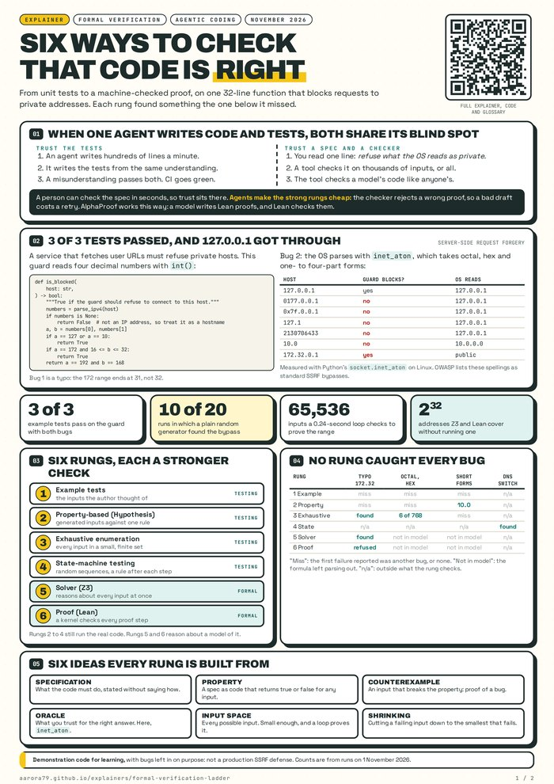
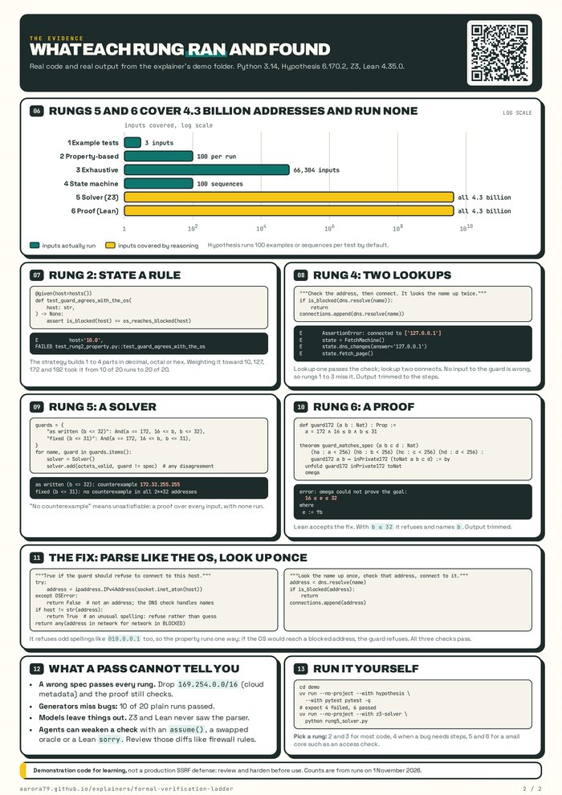

# From unit tests to proofs: six ways to check that code does what it claims

Formal verification is a family of techniques for checking code against a stated rule, from generating thousands of test inputs up to a mathematical proof that covers every input. This page explains the basic ideas from scratch and then climbs six rungs, each a stronger way to check code, on one small function, so you can see what each rung finds and what it costs.

*Written 1 November 2026. The page assumes no background in testing theory or proofs. Every sample on this page ran on that date: Python 3.14 with Hypothesis 6.170.2 and Z3, and Lean 4.35.0.*

| Number | What it is |
| --- | --- |
| **3 of 3** | example tests pass on a guard with two bugs in it |
| **10 of 20** | runs in which a plain random generator found the parsing bug |
| **65,536** | inputs that a loop checks to prove the range check over every address |
| **2^32** | addresses a solver and a proof cover without trying one of them |

 

The whole ladder as a two-page poster: [the poster](poster/), [the PDF](poster/formal-verification-ladder-poster.pdf), and the [front](poster/formal-verification-ladder-poster-front.png) and [back](poster/formal-verification-ladder-poster-back.png) as 300 DPI PNGs.

### Contents

1. [Why this matters when agents write the code](#why-this-matters-when-agents-write-the-code)
2. [The example: a guard against private addresses](#the-example-a-guard-against-private-addresses)
3. [Six ideas the rest of the page uses](#six-ideas-the-rest-of-the-page-uses)
4. [The ladder](#the-ladder)
5. [Rung 1: example tests](#rung-1-example-tests)
6. [Rung 2: property-based testing](#rung-2-property-based-testing)
7. [Rung 3: exhaustive enumeration](#rung-3-exhaustive-enumeration)
8. [Rung 4: state-machine testing](#rung-4-state-machine-testing)
9. [Rung 5: a solver](#rung-5-a-solver)
10. [Rung 6: a machine-checked proof](#rung-6-a-machine-checked-proof)
11. [Fixing the guard, and checking the fix](#fixing-the-guard-and-checking-the-fix)
12. [Choosing a rung](#choosing-a-rung)
13. [What none of this tells you](#what-none-of-this-tells-you)
14. [Run it yourself](#run-it-yourself)
15. [Glossary](#glossary)
16. [Sources](#sources)

## Why this matters when agents write the code

A coding agent can write a few hundred lines of working code in a minute, along with unit tests for it. Nobody reads code that fast, so in practice you trust the tests. That breaks down when the agent wrote both. If it misunderstood what the code should do, its tests check the same misunderstanding, and everything passes.

The example on this page shows that happening. It is a 32-line function with three unit tests that any reviewer would accept. The tests pass, and the function still lets a request through to the machine it runs on and blocks an address it should allow.

The techniques on this page let you trust something you can read. Instead of reading the code, you read a **specification**: a short statement of what the code must do. "The guard must refuse every address the operating system would read as private" is one sentence, and you can check that sentence is right in a few seconds. A tool then checks the code against it. The tool behaves the same whether a person or a model wrote the code, so you no longer have to trust the author, only the specification and the tool.

Agents also make the expensive techniques cheaper. Writing a solver query or a Lean proof used to need a specialist. An agent can draft one in minutes, and the checker rejects a wrong draft, so a bad one costs you a retry and nothing worse. Google DeepMind's AlphaProof, which reached silver-medal standard on the 2024 International Mathematical Olympiad, worked this way: a model wrote proofs in Lean, and Lean checked them.

An agent asked to make a check pass can also weaken the check, so you still review the specification yourself. The last section covers what to look for. The tool does the rest of the reading.

## The example: a guard against private addresses

Many services fetch a URL that a user supplies: a webhook, a link preview, an image import. If the service fetches whatever it receives, a user can point it at `http://127.0.0.1/admin` or at a database on the internal network, and the service makes that request from inside, where the firewall trusts it. The name for this attack is **server-side request forgery**, or SSRF.

The usual defense is a **guard**: a function that looks at the host in the URL and refuses it if it points at a private address. The ranges below cover loopback (the machine itself) and the three private networks set aside in RFC 1918:

| Range | Covers | Example |
|---|---|---|
| `127.0.0.0/8` | Loopback: the machine itself | `127.0.0.1` |
| `10.0.0.0/8` | Private network | `10.0.0.5` |
| `172.16.0.0/12` | Private network, `172.16.0.0` to `172.31.255.255` | `172.20.1.1` |
| `192.168.0.0/16` | Private network | `192.168.1.20` |

This guard is the kind someone, or some agent, might write. It splits the host on dots, reads four numbers, and checks them against the table:

```python
"""A small SSRF guard against private addresses."""

def parse_ipv4(
    host: str,
) -> list[int] | None:
    """Read a dotted address like "10.0.0.5", or return None."""
    parts = host.split(".")
    if len(parts) != 4:
        return None
    try:
        numbers = [int(part) for part in parts]
    except ValueError:
        return None
    if any(n < 0 or n > 255 for n in numbers):
        return None
    return numbers

def is_blocked(
    host: str,
) -> bool:
    """True if the guard should refuse to connect to this host."""
    numbers = parse_ipv4(host)
    if numbers is None:
        return False  # not an IP address, so treat it as a hostname
    a, b = numbers[0], numbers[1]
    if a == 127 or a == 10:
        return True
    if a == 172 and 16 <= b <= 32:
        return True
    return a == 192 and b == 168
```

It looks right, and it has two bugs. The first is a typo: the `172` range should stop at `31`, and the code says `32`, so it blocks the public network `172.32.0.0`. The second takes more explaining, and it is the one that lets the attack through.

The guard reads the host one way, and the operating system reads it another. When the service connects, the C library parses the host with a function called `inet_aton`. Its manual page says each part can be written in decimal, in octal with a leading `0`, or in hex with a leading `0x`, and that an address can have one, two, three or four parts. So the OS reads all of these as `127.0.0.1`:

```text
host            guard blocks?   inet_aton reads
127.0.0.1       True            127.0.0.1
0177.0.0.1      False           127.0.0.1
0x7f.0.0.1      False           127.0.0.1
127.1           False           127.0.0.1
2130706433      False           127.0.0.1
```

The guard reads `0177` as the decimal number 177 and lets it through. It gives up on `0x7f`, `127.1` and `2130706433` because they are not four decimal numbers, and treats them as hostnames. The OS connects to loopback in every case. Attackers have used these spellings for years, and the OWASP SSRF guidance lists hex, octal and dword forms as standard bypasses.

## Six ideas the rest of the page uses

A **specification** says what the code must do, independent of how it does it. For the guard: refuse a host exactly when the OS would read it as an address in one of the four ranges.

A **property** is a specification written as code that returns true or false for any input. Here: `is_blocked(host) == os_reaches_blocked(host)`. A property names no particular input, and that is what separates it from an example test.

A **counterexample** is an input that makes the property false. `"0177.0.0.1"` is one. Finding a counterexample proves there is a bug, either in the code or in the property. Failing to find one proves nothing unless you tried every input.

An **oracle** is whatever you trust to give the right answer. Sometimes it is a short, plain rewrite of the rule, called a **reference model**. Here the best oracle already exists: `inet_aton` itself, because it decides where the connection goes. Wrapped in a few lines of Python, it becomes the function the property compares against:

```python
"""What the operating system would actually connect to."""

import ipaddress
import socket

BLOCKED = [
    ipaddress.ip_network("127.0.0.0/8"),
    ipaddress.ip_network("10.0.0.0/8"),
    ipaddress.ip_network("172.16.0.0/12"),
    ipaddress.ip_network("192.168.0.0/16"),
]

def os_reaches_blocked(
    host: str,
) -> bool:
    """True if the OS would read host as a blocked address."""
    try:
        packed = socket.inet_aton(host)  # the C library's own parser
    except OSError:
        return False  # the OS reads it as a hostname, not an address
    address = ipaddress.IPv4Address(packed)
    return any(address in network for network in BLOCKED)
```

The **input space** is the set of every possible input. For the guard it is every string, which is infinite, so a test can only sample it. When the space is small enough, you can try all of it, and then a pass becomes a proof.

**Shrinking** is what a testing tool does after it finds a failing input: it tries smaller versions until none of them fail, and reports the smallest. A random failure might be `"0xff.0254.012"`. The shrunk one is short enough to understand at once.

## The ladder

The six techniques form a ladder. Each rung up checks more inputs, or all of them, and asks more of you in return. The right side of the diagram shows what each rung found in the guard.

```text
  RUNG                              WHAT IT FOUND IN THE GUARD
  --------------------------------  ---------------------------------------
  6. Machine-checked proof (Lean)   proved the fixed range check for every
     a checked argument, all inputs address; rejected the typo
  5. Solver (Z3)                    found 172.32.255.255, then proved the
     reasons about every input      fix over all 2^32 addresses
  4. State-machine testing          found the DNS switch: checked one
     random sequences of steps      address, connected to another
  3. Exhaustive enumeration         found 172.32.0.1 and 6 bad spellings
     every input in a finite set    out of 65,536 and 768 inputs
  2. Property-based testing         found "10.0", a two-part private
     generated inputs, one rule     address
  1. Example tests                  found nothing: 3 of 3 passed
     the inputs the author chose

  Rungs 2-4 run the real code. Rungs 5-6 reason about it without running.
```

## Rung 1: example tests

An **example test** picks an input, runs the code, and checks the answer. These three cover loopback, two private ranges and one public address:

```python
from guard import is_blocked

def test_blocks_loopback() -> None:
    assert is_blocked("127.0.0.1")

def test_blocks_private() -> None:
    assert is_blocked("10.0.0.5")
    assert is_blocked("192.168.1.20")

def test_allows_public() -> None:
    assert not is_blocked("8.8.8.8")
```

```text
3 passed in 0.28s
```

All three pass, because the author wrote every input the way they thought of it. Nobody writes `assert is_blocked("0177.0.0.1")` without already knowing that octal is a problem, and an agent that does not know about octal writes the same three tests. Example tests are still worth having: they are quick to read and they document intent. They cannot find the case nobody imagined.

### Dry run: what the three tests exercise

Following each test input through `is_blocked` shows which branch it takes:

| Input | `parse_ipv4` returns | Branch taken | Result | Test expects |
|---|---|---|---|---|
| `127.0.0.1` | `[127, 0, 0, 1]` | `a == 127` | `True` | `True` |
| `10.0.0.5` | `[10, 0, 0, 5]` | `a == 10` | `True` | `True` |
| `192.168.1.20` | `[192, 168, 1, 20]` | last line, `a == 192 and b == 168` | `True` | `True` |
| `8.8.8.8` | `[8, 8, 8, 8]` | last line, false | `False` | `False` |

Every input is four decimal numbers, so every one takes the happy path through `parse_ipv4`. Measured with `coverage.py`, the three tests run 15 of the guard's 21 statements. The six they never reach include line 26, the `return False` for anything that is not four numbers, which is where `10.0` escapes in rung 2, and line 31, the `172` branch that holds the typo. A test cannot catch a bug on a line it never runs. Running a line is not enough either: a test with `172.20.1.1` would run line 31 and still pass, because the typo only shows at `172.32`.

## Rung 2: property-based testing

A **property-based test** states the property and lets a library generate the inputs. Hypothesis is the standard Python library for this. You describe the shape of the inputs with a **strategy**, a recipe for generating one kind of value, and Hypothesis runs the test on 100 fresh inputs by default.

```text
                      +--------------------+
                 +--> | guard              | --+
  +-----------+  |    | is_blocked: False  |   |   +----------+   +---------+
  | generate  | -+    +--------------------+   +-> | compare  | ->| shrink  |
  | "0x7f.012"| -+    +--------------------+   +-> | disagree |   | "10.0"  |
  +-----------+  |    | oracle             |   |   +----------+   +---------+
                 +--> | inet_aton: True    | --+
                      +--------------------+
```

The strategy below builds hosts from one to four parts, writing each part in decimal, octal or hex. The property says the guard and the OS agree:

```python
from hypothesis import (
    given,
    strategies as st,
)

from guard import is_blocked
from oracle import os_reaches_blocked

def _spell(
    number: int,
    style: str,
) -> str:
    """Write a number the way inet_aton accepts it."""
    if style == "octal":
        return "0" + format(number, "o")
    if style == "hex":
        return "0x" + format(number, "x")
    return str(number)

# Mix the numbers the guard cares about in with random ones.
NUMBERS = st.one_of(
    st.sampled_from([0, 10, 127, 168, 172, 192, 255]),
    st.integers(min_value=0, max_value=255),
)

@st.composite
def hosts(draw: st.DrawFn) -> str:
    """Hosts with 1 to 4 parts, each in decimal, octal or hex."""
    count = draw(st.integers(min_value=1, max_value=4))
    parts = []
    for _ in range(count):
        number = draw(NUMBERS)
        style = draw(st.sampled_from(["decimal", "octal", "hex"]))
        parts.append(_spell(number, style))
    return ".".join(parts)

@given(host=hosts())
def test_guard_agrees_with_the_os(
    host: str,
) -> None:
    assert is_blocked(host) == os_reaches_blocked(host)
```

```text
E           host='10.0',
FAILED test_rung2_property.py::test_guard_agrees_with_the_os
```

Hypothesis found a disagreement and shrank it to `"10.0"`. The guard and the oracle both read that string, and they take it to mean different things: the guard decides it is not an IP address and lets it through as a hostname, while the OS decides it is the private address `10.0.0.0`.

### Dry run: one string, two readings

Following `"10.0"` through both functions, a line at a time, shows where they part. The values come from running the demo code.

| Step | The guard: `is_blocked("10.0")` | The oracle: `os_reaches_blocked("10.0")` |
|---|---|---|
| 1 | `parse_ipv4` splits on dots and gets `["10", "0"]`: two parts. | It calls `socket.inet_aton("10.0")`, the C function the OS uses to connect. |
| 2 | It needs exactly four parts, so it returns `None`: "not an IP address". | `inet_aton` accepts the two-part form `a.b`: `a` is the first byte, and `b` fills the other three. The bytes are `[10, 0, 0, 0]`. |
| 3 | `is_blocked` sees `None` and takes the hostname branch. | Those bytes are the address `10.0.0.0`, inside the blocked range `10.0.0.0/8`. |
| Result | **`False`: not blocked** | **`True`: a private address** |

The property compares the two results, `False == True`, and fails. In a running service, a request to `http://10.0/` gets past the guard, and the OS connects to `10.0.0.0` on the internal network.

Each function follows its own rules correctly. The guard does what it was written to do, four decimal numbers or a hostname, and `inet_aton` does what its manual page says. The bug exists only in the gap between them, which is why a test that compares the two finds it and a test of either one alone does not.

Shrinking explains why the report says `10.0` and not something longer. Hypothesis keeps the smallest input that still fails, and the inputs next to it pass:

| Host | Guard | OS reads | Oracle | Agree? |
|---|---|---|---|---|
| `10` | not blocked | `0.0.0.10`, public | not blocked | yes |
| `0.0` | not blocked | `0.0.0.0`, not in a range | not blocked | yes |
| `10.0` | not blocked | `10.0.0.0`, private | blocked | **no** |
| `10.0.0.0` | blocked | `10.0.0.0`, private | blocked | yes |

One part is too few to fail: `inet_aton` reads a single part as the whole 32-bit number, so `10` means the public `0.0.0.10`. Four parts are too many, because the guard reads four parts correctly. Two parts is the smallest count that fails, and 10 is the smallest number in the test's list of interesting values that makes the address private. The same gap lets `127.0`, `10.1` and `10.300` through; the OS reads the last one as `10.0.1.44`.

> #### The generator decides what the test can find
>
> The first version of this strategy drew every number uniformly from 0 to 255. Across 20 runs it found the bug in 10. Private addresses start with 10, 127, 172 or 192, so a uniform draw rarely lands on one. Mixing those numbers in with the random ones raised it to 20 runs out of 20. A passing property test means only that the generator did not reach the bug, so check that it can: break the code on purpose and confirm the test fails.

## Rung 3: exhaustive enumeration

The input space of strings is infinite, but parts of the problem are not. Every address has four numbers from 0 to 255, and in this guard only the first two decide the answer. That is 256 × 256 = 65,536 cases, and a loop tries them all in about a quarter of a second. When a test tries every input in a set, a pass is a proof over that set.

The second test applies the same idea to spelling: it writes each first number from 0 to 255 in decimal, octal and hex, which is 768 hosts.

```python
from guard import is_blocked
from oracle import os_reaches_blocked

def test_every_first_two_octets() -> None:
    """Only the first two numbers decide the answer: try all 65,536."""
    wrong = []
    for a in range(256):
        for b in range(256):
            host = f"{a}.{b}.0.1"
            if is_blocked(host) != os_reaches_blocked(host):
                wrong.append(host)
    assert wrong == [], "wrong:\n" + "\n".join(wrong)

def test_every_spelling_of_the_first_octet() -> None:
    """Each number 0-255 in decimal, octal and hex: 768 hosts."""
    wrong = []
    for a in range(256):
        for first in (str(a), "0" + format(a, "o"), hex(a)):
            host = f"{first}.0.0.1"
            if is_blocked(host) != os_reaches_blocked(host):
                wrong.append(host)
    assert wrong == [], "wrong:\n" + "\n".join(wrong)
```

```text
E       AssertionError: wrong:
E         172.32.0.1

E       AssertionError: wrong:
E         010.0.0.1
E         012.0.0.1
E         0xa.0.0.1
E         0127.0.0.1
E         0177.0.0.1
E         0x7f.0.0.1
```

The first test finds the typo and nothing else. Out of 65,536 pairs, only `172.32` gets the wrong answer, and once you fix the typo the loop proves the range check right for every address.

### Dry run: one slice of each sweep

In the first test, the slice where `a` is 172 shows the typo. The guard's check reads `16 <= b <= 32`, and the range it is meant to match ends at 31:

| `b` | Host | Guard | OS (oracle) | Agree? |
|---|---|---|---|---|
| 15 | `172.15.0.1` | allowed | allowed | yes |
| 16 | `172.16.0.1` | blocked | blocked | yes |
| 31 | `172.31.0.1` | blocked | blocked | yes |
| 32 | `172.32.0.1` | blocked | allowed | **no** |
| 33 | `172.33.0.1` | allowed | allowed | yes |

Only one pair out of 65,536 disagrees, so a random sampler that draws 100 pairs has about a 1 in 650 chance of landing on it. The loop lands on it every time.

In the second test, the spellings of 10 and 127 show the parsing gap. Python's `int()` reads a leading zero as decimal, so `int("012")` is 12. `inet_aton` reads a leading zero as octal, so `012` is 10:

| Host | Guard reads | Guard | OS reads | OS (oracle) | Agree? |
|---|---|---|---|---|---|
| `10.0.0.1` | 10 | blocked | `10.0.0.1` | blocked | yes |
| `012.0.0.1` | 12 | allowed | `10.0.0.1` | blocked | **no**: gets through |
| `0xa.0.0.1` | not a number: hostname | allowed | `10.0.0.1` | blocked | **no**: gets through |
| `010.0.0.1` | 10 | blocked | `8.0.0.1` | allowed | **no**: blocked by mistake |
| `0177.0.0.1` | 177 | allowed | `127.0.0.1` | blocked | **no**: gets through |
| `0x7f.0.0.1` | not a number: hostname | allowed | `127.0.0.1` | blocked | **no**: gets through |
| `0127.0.0.1` | 127 | blocked | `87.0.0.1` | allowed | **no**: blocked by mistake |

The proof covers only the set you chose. The first test needed the insight that only two octets matter, and the second covers only one part of the address. Neither says anything about a spelling like `127.1`. Picking the set is where the judgment goes.

## Rung 4: state-machine testing

Some bugs are not in any single call. They show up only after a particular sequence of events. A guard that checks a hostname has one: it looks up the name to get an address, checks the address, and then the HTTP client looks the name up again to connect. If the DNS answer changes between the two lookups, the guard approves one address and the client connects to another. The attack is **DNS rebinding**, and the bug pattern behind it has the name **time-of-check to time-of-use**.

```text
  lookup 1          check             DNS changes        lookup 2, connect
  93.184.216.34 --> public: allow --> now 127.0.0.1 ---> 127.0.0.1
  ------------------------------------------------------------------> time

  Each step is correct alone. The bug is in the gap between check and use.
```

A **state machine** test models the system as some state plus a set of actions that change it, which Hypothesis calls **rules**. You also write **invariants**: properties of the state that must hold after every step. Hypothesis runs random sequences of rules, checks the invariants after each one, and shrinks a failing sequence to the shortest one that still fails.

Here the state is a fake DNS server and a list of addresses the client connected to. One rule queues a new DNS answer, another fetches a page, and the invariant says the client never connected to a blocked address:

```python
from hypothesis import strategies as st
from hypothesis.stateful import (
    RuleBasedStateMachine,
    invariant,
    rule,
)

from guard import is_blocked
from oracle import os_reaches_blocked

PUBLIC = "93.184.216.34"
LOOPBACK = "127.0.0.1"

class FakeDns:
    """Hands out queued answers, then repeats the last one."""

    def __init__(self) -> None:
        self.answers: list[str] = [PUBLIC]

    def resolve(self, name: str) -> str:
        if len(self.answers) > 1:
            return self.answers.pop(0)
        return self.answers[0]

def fetch(
    dns: FakeDns,
    name: str,
    connections: list[str],
) -> None:
    """Check the address, then connect. It looks the name up twice."""
    if is_blocked(dns.resolve(name)):
        return
    connections.append(dns.resolve(name))

class FetchMachine(RuleBasedStateMachine):
    fetch_function = staticmethod(fetch)

    def __init__(self) -> None:
        super().__init__()
        self.dns = FakeDns()
        self.connections: list[str] = []

    @rule(answer=st.sampled_from([PUBLIC, LOOPBACK]))
    def dns_changes(self, answer: str) -> None:
        self.dns.answers.append(answer)

    @rule()
    def fetch_page(self) -> None:
        self.fetch_function(self.dns, "example.test", self.connections)

    @invariant()
    def never_connected_to_a_blocked_address(self) -> None:
        bad = [ip for ip in self.connections if os_reaches_blocked(ip)]
        assert bad == [], f"connected to {bad}"

TestFetch = FetchMachine.TestCase
```

```text
E       AssertionError: connected to ['127.0.0.1']
E       state = FetchMachine()
E       state.never_connected_to_a_blocked_address()
E       state.dns_changes(answer='127.0.0.1')
E       state.never_connected_to_a_blocked_address()
E       state.fetch_page()
E       state.never_connected_to_a_blocked_address()
E       state.teardown()
```

Hypothesis checks the invariant before and after every step, and the shortest failing sequence has two steps. No input to `is_blocked` is wrong here, so rungs 1 to 3 cannot see this bug at all.

### Dry run: the two-step sequence

Replaying the failing sequence with a log on the fake DNS server shows the queue of answers at each step:

| Step | What happens | DNS queue afterwards | Connections |
|---|---|---|---|
| Start | The fake DNS holds one answer. | `[93.184.216.34]` | `[]` |
| 1 | `dns_changes('127.0.0.1')` queues a second answer. | `[93.184.216.34, 127.0.0.1]` | `[]` |
| 2a | `fetch_page`: lookup 1 returns `93.184.216.34`, and `is_blocked` says `False`, so the fetch carries on. | `[127.0.0.1]` | `[]` |
| 2b | Lookup 2 returns `127.0.0.1`, and the client connects to it. | `[127.0.0.1]` | `[127.0.0.1]` |
| Check | The invariant asks the oracle about each connection: `127.0.0.1` is blocked. |  | **fails** |

The guard answered correctly both times it was asked. It was asked about the wrong address: the one from lookup 1, while the connection used lookup 2. Without step 1 both lookups return the public address and the test passes, which is why Hypothesis could not shrink the sequence below two steps. A real attacker gets the same effect from a DNS server that answers with a time-to-live of zero, so the second lookup goes back to the server instead of reusing the first answer.

The fix is in `fetch`: look the name up once, check that address, and connect to that same address.

## Rung 5: a solver

Rung 3 proved the range check by trying 65,536 cases, and that worked only because someone spotted that two octets decide the answer. A **solver** needs no such insight. You describe the inputs and the condition you are looking for as logic, and the solver either finds values that make it true or proves none exist. An **SMT solver** (satisfiability modulo theories) is the kind that understands numbers and arithmetic, and Z3, from Microsoft Research, is one of the most common. Answering "is there any input where X happens" this way, without running the code, is the first rung most people would call formal verification.

The script below writes the range check and the specification as formulas over four octets, then asks Z3 for any address where the two disagree:

```python
"""Ask Z3 if the range check can disagree with the spec."""

from z3 import (
    And,
    Ints,
    Solver,
    sat,
)

a, b, c, d = Ints("a b c d")
octets_valid = And([And(0 <= x, x <= 255) for x in (a, b, c, d)])
address = a * 2**24 + b * 2**16 + c * 2**8 + d

# The spec: 172.16.0.0 to 172.31.255.255, written as one number range.
low = 172 * 2**24 + 16 * 2**16
high = 172 * 2**24 + 31 * 2**16 + 255 * 2**8 + 255
spec = And(low <= address, address <= high)

guards = {
    "as written (b <= 32)": And(a == 172, 16 <= b, b <= 32),
    "fixed (b <= 31)": And(a == 172, 16 <= b, b <= 31),
}
for name, guard in guards.items():
    solver = Solver()
    solver.add(octets_valid, guard != spec)  # any disagreement
    if solver.check() == sat:
        m = solver.model()
        found = ".".join(str(m.eval(x)) for x in (a, b, c, d))
        print(f"{name}: counterexample {found}")
    else:
        print(f"{name}: no counterexample in all 2**32 addresses")
```

```text
as written (b <= 32): counterexample 172.32.255.255
fixed (b <= 31): no counterexample in all 2**32 addresses
```

For the code as written, Z3 returns `172.32.255.255`, inside the range the guard blocks and outside the one the specification names. For the fixed check it answers that the formula is **unsatisfiable**: no assignment of four octets makes them disagree. That covers all 4,294,967,296 addresses, and Z3 did not try any of them. It reasoned about the arithmetic instead.

### Dry run: what Z3 is asked, and what it answers

The line `guard != spec` asks whether the two can disagree in either direction. Splitting it into its two halves shows which half fails:

| Question | As written (`b <= 32`) | Fixed (`b <= 31`) |
|---|---|---|
| Can the guard block an address the spec allows? | satisfiable: `172.32.255.255` | unsatisfiable |
| Can the spec cover an address the guard misses? | unsatisfiable | unsatisfiable |

The counterexample checks out by hand. As one number, `172.32.255.255` is 172 × 2^24 + 32 × 2^16 + 255 × 2^8 + 255 = 2,887,843,839. The spec's range ends at 2,887,778,303, so the spec says allowed, while the guard sees `a = 172` and `b = 32` and blocks it. Any values of `c` and `d` would do; Z3 returns whichever model it finds first.

For the fixed check, Z3 reaches "unsatisfiable" through rules of arithmetic rather than by trying values. The argument it settles is the one you would make on paper. If the guard blocks, then `a = 172` and `b` is between 16 and 31, so the address lies between `172.16.0.0` and `172.31.255.255`, inside the spec. If the spec covers an address, it lies in that same range, which forces `a = 172` and `b` between 16 and 31, so the guard blocks. Neither half has a solution, and that covers every address without listing one.

Solvers have limits. This one checked a formula that a person wrote to match the Python, not the Python itself, and the parsing bug never appears in the formula. Tools such as CrossHair run a solver over the Python functions themselves, and they handle small pure functions over numbers well. Strings, regular expressions and network calls are much harder for them.

## Rung 6: a machine-checked proof

A **proof assistant** checks a proof step by step and refuses any step that does not follow from the ones before it. Lean is widely used by mathematicians, and it is the language AlphaProof wrote its proofs in. You write a **theorem**, a statement claimed to be true, and a proof of it. Lean's **kernel**, a small checker at its core, accepts the proof only if every step is valid. Once it does, the theorem holds for every input it covers. Nothing was sampled, and nothing depends on a solver finishing in time.

This file states the range check and the specification in Lean and proves that they agree for every four octets below 256:

```lean
-- An IPv4 address as one number, from its four octets.
def toNat (a b c d : Nat) : Nat :=
  a * 16777216 + b * 65536 + c * 256 + d

-- The spec: 172.16.0.0 through 172.31.255.255.
def inPrivate172 (n : Nat) : Prop :=
  2886729728 ≤ n ∧ n ≤ 2887778303

-- The guard's check, fixed to stop at 31.
def guard172 (a b : Nat) : Prop :=
  a = 172 ∧ 16 ≤ b ∧ b ≤ 31

theorem guard_matches_spec (a b c d : Nat)
    (ha : a < 256) (hb : b < 256) (hc : c < 256) (hd : d < 256) :
    guard172 a b ↔ inPrivate172 (toNat a b c d) := by
  unfold guard172 inPrivate172 toNat
  omega
```

Read the theorem as a sentence: for all numbers `a`, `b`, `c` and `d`, if each is below 256, the guard's check holds exactly when the address lies in the range. The names in parentheses, `ha` through `hd`, are **hypotheses**, the assumptions the proof may use. The two lines after `by` are the proof. Each is a **tactic**, a command that builds proof steps: `unfold` replaces each name with its definition, and `omega` settles any goal made of whole-number arithmetic and comparisons. Lean accepts this file with no output.

Put the typo back, so the check reads `b ≤ 32`, and Lean refuses:

```text
error: omega could not prove the goal:
a possible counterexample may satisfy the constraints
  0 ≤ g ≤ 255
  0 ≤ f ≤ 255
  16 ≤ e ≤ 32
  65536*e + 256*f + g ≥ 2097152
where
 e := ↑b
 f := ↑c
 g := ↑d
```

### Dry run: the proof one tactic at a time

Lean can print its **goal**, the statement still left to prove, between tactics. Before `unfold`, the goal names the three definitions, with the four hypotheses listed above it:

```text
a b c d : Nat
ha : a < 256
hb : b < 256
hc : c < 256
hd : d < 256
⊢ guard172 a b ↔ inPrivate172 (toNat a b c d)
```

After `unfold`, each name is replaced by its definition, and the goal is plain arithmetic over whole numbers:

```text
⊢ a = 172 ∧ 16 ≤ b ∧ b ≤ 31 ↔
    2886729728 ≤ a * 16777216 + b * 65536 + c * 256 + d ∧
    a * 16777216 + b * 65536 + c * 256 + d ≤ 2887778303
```

`omega` is a decision procedure: for any goal made of additions, multiplications by constants and comparisons, it either proves the goal or reports that it cannot. Here it proves both directions of the `↔` using the four bounds, so Lean accepts the theorem and prints nothing. (Lean prints the same four hypotheses above this goal, and the right-hand side as one long line; both are trimmed here to fit.)

With the typo, the goal says `b ≤ 32` instead, and the error above is `omega` reporting the region where a counterexample may lie.

Decoded: `e`, `f` and `g` stand for `b`, `c` and `d`, and `a` is missing because the guard's side of the claim has already fixed it at 172. The last line says `b × 65536 + c × 256 + d` is at least 2,097,152, which is 32 × 65536: the address is at or past `172.32.0.0`, outside the range. Together with `b ≤ 32`, that leaves `b = 32` and any `c` and `d`, so the counterexample region is `172.32.x.x`, the same place the solver pointed.

Rung 6 gives the strongest guarantee here, and it covers the least ground. The theorem is about the Lean definition `guard172`, not the Python function, and the parsing bug that let `0177.0.0.1` through is not in it at all. To prove the whole guard, you would have to describe in Lean exactly how `inet_aton` reads a string, and how Python's `int` does, and then prove the two agree. Projects that do this exist. seL4, an operating-system kernel proved correct in Isabelle, a proof assistant similar to Lean, needed about 200,000 lines of proof for about 8,700 lines of C.

## Fixing the guard, and checking the fix

The ladder found three kinds of bug: the typo, the parsing mismatch and the double lookup. The fixed version deals with each one:

```python
"""The guard after the fixes the ladder pointed at."""

import ipaddress
import socket
from typing import Protocol

BLOCKED = [
    ipaddress.ip_network("127.0.0.0/8"),
    ipaddress.ip_network("10.0.0.0/8"),
    ipaddress.ip_network("172.16.0.0/12"),
    ipaddress.ip_network("192.168.0.0/16"),
]

class Resolver(Protocol):
    def resolve(self, name: str) -> str: ...

def is_blocked(
    host: str,
) -> bool:
    """True if the guard should refuse to connect to this host."""
    try:
        address = ipaddress.IPv4Address(socket.inet_aton(host))
    except OSError:
        return False  # not an address; the DNS check handles names
    if host != str(address):
        return True  # an unusual spelling: refuse rather than guess
    return any(address in network for network in BLOCKED)

def fetch(
    dns: Resolver,
    name: str,
    connections: list[str],
) -> None:
    """Look the name up once, check that address, connect to it."""
    address = dns.resolve(name)
    if is_blocked(address):
        return
    connections.append(address)
```

The guard now parses the host with `inet_aton`, the same function the OS uses, so the two cannot disagree about which address a string means. It refuses any spelling that is not plain four-part decimal, because nothing legitimate needs `0177.0.0.1`. It checks the ranges with Python's `ipaddress` module instead of hand-written comparisons, which removes the typo. And `fetch` looks the name up once and connects to the address it checked.

The fix changes the specification, and the property has to change with it. The guard now refuses some hosts the OS would read as public, such as `010.0.0.1`, so the exact-agreement property from rung 2 would fail. That failure is not a bug: refusing an odd spelling is safe. The property you want is one-directional: whenever the OS would reach a blocked address, the guard refuses.

```python
from hypothesis import given

import guard_fixed
from oracle import os_reaches_blocked
from test_rung2_property import hosts
from test_rung4_state import FetchMachine

@given(host=hosts())
def test_never_lets_a_blocked_address_through(
    host: str,
) -> None:
    if os_reaches_blocked(host):
        assert guard_fixed.is_blocked(host)

def test_every_first_two_octets() -> None:
    for a in range(256):
        for b in range(256):
            host = f"{a}.{b}.0.1"
            expected = os_reaches_blocked(host)
            assert guard_fixed.is_blocked(host) == expected

class FixedFetchMachine(FetchMachine):
    fetch_function = staticmethod(guard_fixed.fetch)

TestFixedFetch = FixedFetchMachine.TestCase
```

```text
3 passed in 2.61s
```

Deciding which direction the property runs in is a design choice, and no tool makes it for you. A security guard usually wants the one-directional form: never let a bad host through, and tolerate refusing a few odd good ones.

### Dry run: the fixed guard on the hosts that broke the old one

| Host | `inet_aton` reads | Plain spelling? | Fixed guard | OS (oracle) |
|---|---|---|---|---|
| `10.0` | `10.0.0.0` | no | refuses | blocked |
| `0177.0.0.1` | `127.0.0.1` | no | refuses | blocked |
| `010.0.0.1` | `8.0.0.1` | no | refuses | allowed |
| `10.0.0.5` | `10.0.0.5` | yes | refuses: in `10.0.0.0/8` | blocked |
| `8.8.8.8` | `8.8.8.8` | yes | allows | allowed |
| `example.com` | not an address | n/a | allows: a name, checked after lookup | allowed |

The `010.0.0.1` row is the one-way property at work: the guard refuses a host the OS would read as public, which is safe, so the property allows it. Every row where the OS would reach a blocked address is a row the guard refuses. For the double lookup, the fixed `fetch` stores the one answer it gets and connects to that, so step 2b in the rung 4 replay would connect to `93.184.216.34`, the address it checked.

## Choosing a rung

| Rung | You write | A pass means | Use it when |
|---|---|---|---|
| 1. Example tests | Inputs and expected answers | Those inputs work | Always, to document intent |
| 2. Property-based | A rule and a generator | No counterexample in the inputs tried | The function is pure and its input space is large |
| 3. Exhaustive | A rule and a loop | Correct for every input in the set | The inputs that matter form a small, finite set |
| 4. State machine | Rules, invariants, a fake world | No failing sequence among those tried | The bug needs several steps in a row |
| 5. Solver | The code and the rule as logic | Correct for every input, for that formula | Arithmetic, ranges, permissions or policies |
| 6. Proof | A theorem and its proof | Correct for every input, for that model | A small core that must never be wrong |

Most projects get the most for the least from rungs 2 and 3. They run your real code, they fit in an ordinary test suite, and an agent can write them as fast as it writes unit tests. Rungs 5 and 6 pay off for a small piece of logic that many things depend on: an access check, a range table, a parser. Amazon Web Services built Zelkova, an SMT-based checker for its access policies, for that reason.

## What none of this tells you

Every rung checks the code against the specification, so a wrong specification passes every rung. If the four ranges had left out `169.254.0.0/16`, the range where cloud providers run the metadata service that hands out server credentials, every test and the proof would still pass. The specification is the part a person has to read.

Rungs 2 and 4 cover only what the generator reaches. The callout in rung 2 showed a correct property passing half its runs over a real bug.

Rungs 5 and 6 cover only the model. Each checked a formula or definition that someone wrote to match the Python. That model left parsing out, so neither saw the parsing bug.

An agent can weaken any of these checks to make them pass. It can narrow the generator, change `==` to a one-way check without saying why, add `assume(...)` calls that skip the inputs that fail, swap the oracle for a copy of the code under test, or leave a Lean proof unfinished with `sorry`, which Lean accepts with a warning. When an agent changes a property, a strategy, an oracle or a theorem statement, review that change the way you would review a change to the firewall rules. Fail CI on any `sorry` in a Lean file.

## Run it yourself

Every file on this page is in `demo/` beside it. The tests need only `uv`:

```bash
cd demo
uv run --no-project --with hypothesis --with pytest \
  pytest -q
uv run --no-project --with z3-solver python rung5_solver.py
```

Expect 4 failures and 6 passes: the four rung tests fail on the original guard, and the three example tests and three checks on the fixed guard pass. To check the Lean file, install a throwaway toolchain under `/tmp` (it takes about 3 GB of disk; delete `/tmp/elan` afterwards):

```bash
curl -sSfL -o /tmp/elan-init.sh \
  https://raw.githubusercontent.com/leanprover/elan/master/elan-init.sh
export ELAN_HOME=/tmp/elan
sh /tmp/elan-init.sh -y --no-modify-path \
  --default-toolchain leanprover/lean4:stable
/tmp/elan/bin/lean Rung6.lean  # no output: the proof checked
```

Then try three edits. Change `b ≤ 31` to `b ≤ 32` in `Rung6.lean` and watch Lean refuse. Replace `NUMBERS` in the rung 2 test with `st.integers(min_value=0, max_value=255)` and run it a few times. Change `fetch` in `test_rung4_state.py` to look the name up once and connect to that address, and watch rung 4 pass.

## Glossary

| Term | Meaning |
|---|---|
| Counterexample | An input that makes a property false. Finding one proves a bug exists, in the code or in the property. |
| Decision procedure | An algorithm that always finishes with a yes or no for every question in its class, such as Lean's `omega` for whole-number arithmetic. |
| DNS rebinding | Making a hostname answer with one address when it is checked and another when it is used. |
| Example test | A test that runs the code on one input the author chose and checks the answer. |
| Exhaustive enumeration | Trying every input in a finite set. A pass is a proof over that set. |
| Formal verification | Checking code against a specification by reasoning about every input, rather than by running it on some. |
| Goal (Lean) | The statement still left to prove at a point in a proof. Each tactic changes it, and the proof ends when no goal remains. |
| Guard | A function that decides whether a request may go ahead, here whether a host is safe to connect to. |
| Hypothesis (Lean) | An assumption a proof may use, such as `a < 256`. |
| Hypothesis (Python) | A library for property-based testing in Python. |
| `inet_aton` | The C library function that turns a host string into an IPv4 address. It accepts octal, hex and one- to four-part forms. |
| Input space | The set of every input a function can receive. |
| Invariant | A property of a system's state that must hold after every step. |
| Kernel (Lean) | The small checker at the core of Lean that accepts or rejects each proof. |
| Loopback | The address range `127.0.0.0/8`, which always means the machine itself. |
| Oracle | Whatever a test trusts to give the right answer, such as a reference model or the real system. |
| Private address | An address reserved for internal networks: `10.0.0.0/8`, `172.16.0.0/12` and `192.168.0.0/16`. |
| Proof assistant | A program that checks a proof step by step, such as Lean, Coq or Isabelle. |
| Property | A specification written as code that returns true or false for any input. |
| Property-based test | A test that checks a property on many generated inputs. |
| Reference model | A short, plain implementation of a rule, used as an oracle. |
| Rule (Hypothesis) | One action in a state-machine test, such as fetching a page. |
| Shrinking | Reducing a failing input to the smallest one that still fails. |
| SMT solver | A program that decides whether a logical formula over numbers and other types can be true. Z3 is one. |
| Specification | A statement of what code must do, independent of how it does it. |
| SSRF | Server-side request forgery: getting a server to make a request to a place the attacker cannot reach directly. |
| State machine | A model of a system as a state plus actions that change it. |
| Strategy (Hypothesis) | A recipe for generating one kind of test input. |
| Tactic (Lean) | A command that builds proof steps, such as `unfold` or `omega`. |
| Theorem | A statement claimed to be true, which a proof establishes. |
| Time-of-check to time-of-use | A bug where a value changes between the moment code checks it and the moment code uses it. |
| Unsatisfiable | Said of a formula that no assignment of values can make true. A solver uses it to prove no counterexample exists. |

## Sources

- `inet_aton(3)`, Linux manual page: the one- to four-part forms and the octal and hex rules. [man7.org/linux/man-pages/man3/inet_aton.3.html](https://man7.org/linux/man-pages/man3/inet_aton.3.html).
- OWASP, *Server-Side Request Forgery Prevention Cheat Sheet*: hex, octal and dword bypasses, and DNS rebinding. [cheatsheetseries.owasp.org](https://cheatsheetseries.owasp.org/cheatsheets/Server_Side_Request_Forgery_Prevention_Cheat_Sheet.html).
- Python `ipaddress` module: [docs.python.org/3/library/ipaddress.html](https://docs.python.org/3/library/ipaddress.html).
- Hypothesis documentation: [hypothesis.readthedocs.io](https://hypothesis.readthedocs.io/en/latest/); stateful testing: [hypothesis.readthedocs.io/en/latest/stateful.html](https://hypothesis.readthedocs.io/en/latest/stateful.html).
- Koen Claessen and John Hughes, "QuickCheck: A Lightweight Tool for Random Testing of Haskell Programs", ICFP 2000, where property-based testing started: [dl.acm.org/doi/10.1145/351240.351266](https://dl.acm.org/doi/10.1145/351240.351266).
- Z3 theorem prover: [github.com/Z3Prover/z3](https://github.com/Z3Prover/z3); online guide: [microsoft.github.io/z3guide](https://microsoft.github.io/z3guide/).
- CrossHair, a solver-backed checker for Python: [github.com/pschanely/CrossHair](https://github.com/pschanely/CrossHair).
- Lean: [lean-lang.org](https://lean-lang.org/); *Theorem Proving in Lean 4*: [lean-lang.org/theorem_proving_in_lean4](https://lean-lang.org/theorem_proving_in_lean4/).
- Google DeepMind, "AI achieves silver-medal standard solving International Mathematical Olympiad problems", July 2024, on AlphaProof writing proofs in Lean: [deepmind.google](https://deepmind.google/discover/blog/ai-solves-imo-problems-at-silver-medal-level/).
- Gerwin Klein et al., "seL4: Formal Verification of an OS Kernel", SOSP 2009: 8,700 lines of C and 200,000 lines of Isabelle proof. [sigops.org](https://www.sigops.org/s/conferences/sosp/2009/papers/klein-sosp09.pdf).
- John Backes et al., "Semantic-based Automated Reasoning for AWS Access Policies using SMT", FMCAD 2018 (Zelkova): [amazon.science](https://www.amazon.science/publications/semantic-based-automated-reasoning-for-aws-access-policies-using-smt).
- Demo runs on 1 November 2026: the files in `demo/` under Python 3.14, Hypothesis 6.170.2, pytest, Z3 and Lean 4.35.0. The 10-of-20 and 20-of-20 figures come from 20 runs of each generator with the example database cleared before each run.
